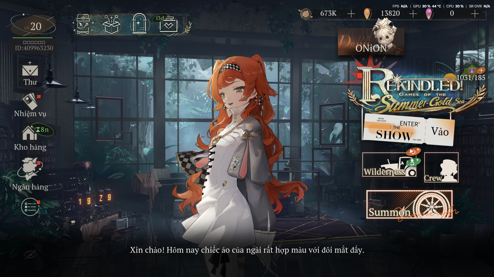
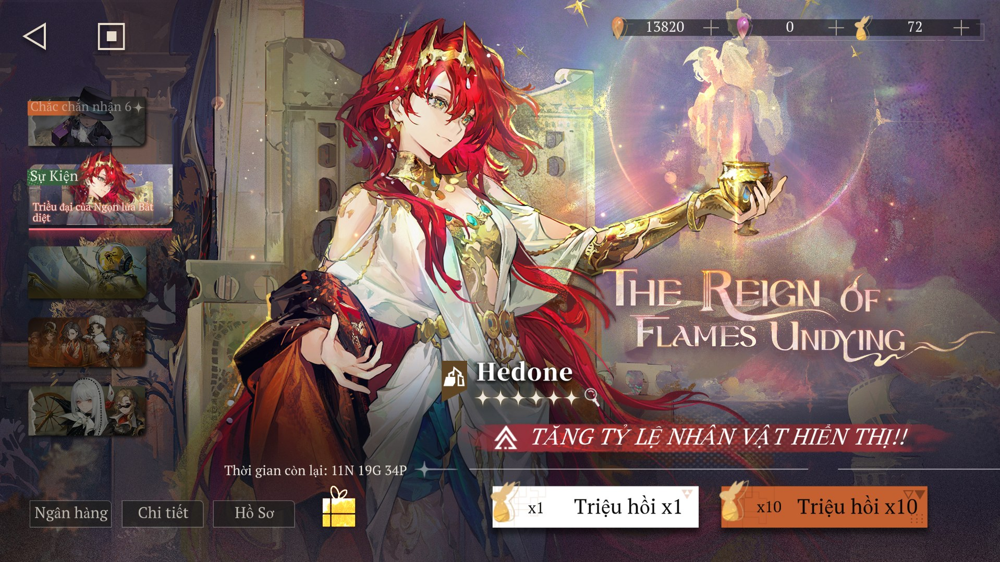
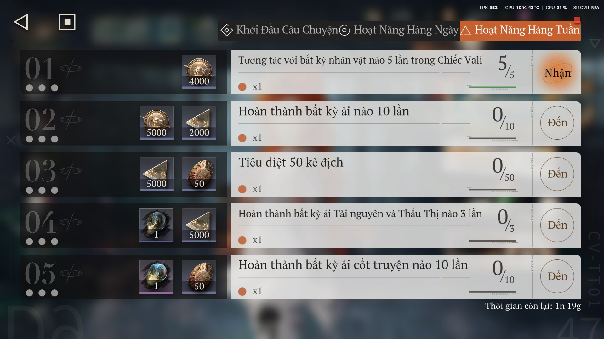
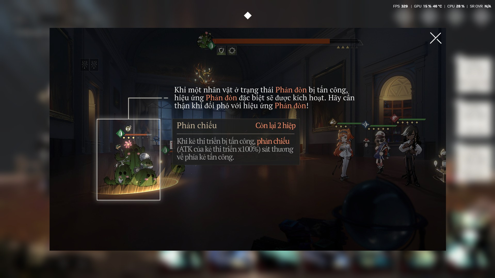
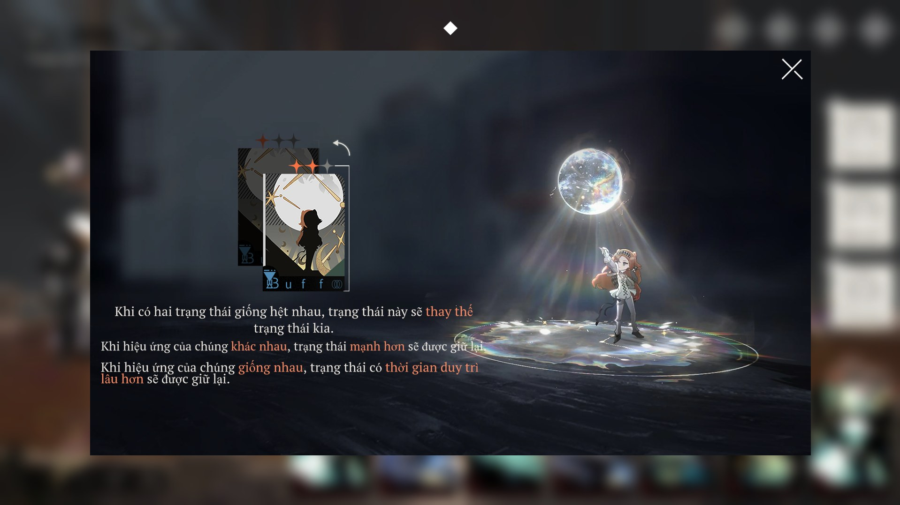
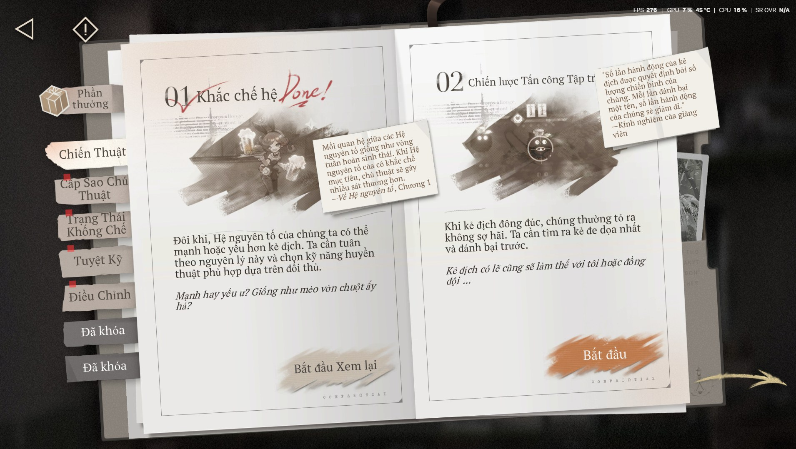

# 🇻🇳 Reverse: 1999 Việt Hóa — Bản Dịch Tiếng Việt Hoàn Chỉnh (PC Global)

> **Bản Việt hóa đầy đủ nhất** cho game **Reverse: 1999** phiên bản PC Global (Steam / Launcher chính hãng).
> Dịch toàn bộ giao diện, cốt truyện, hội thoại, lựa chọn nhánh, thoại nhân vật, và phụ đề video — hoàn toàn miễn phí, an toàn, không sửa file gốc.

---

## 📸 Ảnh Minh Họa

  
  

  
  

  
  

---

## ✨ Tính Năng Nổi Bật

| Nội dung | Mức độ Việt hóa |
|---|---|
| 🖥️ **Giao diện (UI) & Dữ liệu Server** — Menu, Cài đặt, Kho đồ, Hồ sơ nhân vật, Trang phục, Mô tả kỹ năng | ✅ **100%** (152.850 dòng) |
| 🎤 **Thoại nhân vật** — Toàn bộ phụ đề sảnh chính, trận đấu, tương tác | ✅ **100%** (7.274 câu thoại, 136 nhân vật) |
| 📜 **Tài liệu & Thư từ** — Báo chí, hồ sơ Laplace, mẩu tin cốt truyện | ✅ **100%** (367 tài liệu lore in-game) |
| 📖 **Cốt truyện chính & Sự kiện** — Toàn bộ **Chương 1 → 13 & Mọi Event lớn (1.1 → 2.8+)** | ✅ **100%** (73.958 câu thoại độc nhất, gần 100.000 lượt thoại game) |
| 🗣️ **Nhánh lựa chọn hội thoại** — Tất cả câu trả lời của Vertin (người chơi) | ✅ **100%** |
| 🎬 **Video PV / Cutscene** — Phụ đề tiếng Việt nhúng trực tiếp & kiểm toán toàn bộ 54 video | ✅ **Hoàn tất 100%** |
| 🔤 **Font tiếng Việt** — Sắc nét, chuẩn phong cách tiểu thuyết châu Âu | ✅ Tích hợp sẵn |

> **Tổng cộng:** Hơn **235.000+ dòng** dữ liệu văn bản, hội thoại và tư liệu đã được Việt hóa trọn vẹn theo phong cách văn học châu Âu cổ điển.

---

## 📥 Hướng Dẫn Cài Đặt

Người chơi có thể tùy chọn 1 trong 3 hình thức cài đặt phù hợp với nhu cầu:

### 👉 Tải bản cài đặt:
Truy cập trang phát hành chính thức: **[Tải Bản Việt Hóa Mới Nhất Tại Đây (Releases)](https://github.com/lehoangthuan4568/Reverse1999-VietHoa/releases/latest)**

* 📦 **Gói Tự Động (`Reverse1999_VietHoa_PC.zip`):** Tích hợp Trình cài đặt C# WinForms 1-Click + Script Batch minh bạch.
* 📂 **Gói Thủ Công (`Reverse1999_VietHoa_Manual_CopyPaste.zip`):** Dành cho ai muốn tự Copy - Paste thuần túy, không chứa file thực thi.

---

### 🔹 Cách 1: Sử Dụng Bộ Cài 1-Click (Khuyên Dùng)
1. Tải và giải nén `Reverse1999_VietHoa_PC.zip`.
2. Chạy ứng dụng **`CaiDat_VietHoa_Reverse1999.exe`**.
   > *Lưu ý: Ứng dụng được viết bằng **C# Native .NET Framework**, biên dịch trực tiếp không qua phần mềm đóng gói bên thứ ba, siêu nhẹ (~160KB) và an toàn tuyệt đối, không bị Windows Defender báo nhầm.*
3. Ứng dụng sẽ tự động nhận diện thư mục game `Reverse1999en` (Steam hoặc Launcher).
4. Bấm nút **`[CÀI ĐẶT / CẬP NHẬT VIỆT HÓA]`** → Xong! 🎉
5. Bấm **`[MỞ GAME LAUNCHER]`** để vào game trải nghiệm.

### 🔹 Cách 2: Sử Dụng Script Minh Bạch (`CaiDat_Bang_Script.bat`)
1. Trong thư mục vừa giải nén của `Reverse1999_VietHoa_PC.zip`, mở file **`CaiDat_Bang_Script.bat`**.
   > *Bạn có thể click chuột phải chọn Edit hoặc mở bằng Notepad để kiểm tra 100% từng dòng lệnh trước khi chạy.*
2. Nhập phím **`1`** rồi Enter để tự động cài đặt.
3. Khi muốn gỡ bỏ, chỉ cần nhập phím **`2`**.

### 🔹 Cách 3: Cài Đặt Thủ Công (Copy - Paste)
1. Tải và giải nén `Reverse1999_VietHoa_Manual_CopyPaste.zip`.
2. Mở thư mục cài đặt game của bạn: `Reverse1999en` (nơi chứa `reverse1999.exe`).
3. Sao chép (Copy) 3 mục: file `version.dll`, file `viethoa.dat` và thư mục `reverse1999_Data`.
4. Dán (Paste) thẳng vào thư mục `Reverse1999en`.
5. Khởi động game từ Launcher / Steam bình thường!

---

## 🔄 Cập Nhật Khi Game Update

Khi game ra bản cập nhật mới (patch/version mới):

1. Mở lại `CaiDat_VietHoa_Reverse1999.exe` (hoặc `CaiDat_Bang_Script.bat`)
2. Bấm **`[GỠ BỎ VIỆT HÓA]`**
3. Mở Launcher để game cập nhật bình thường
4. Sau khi cập nhật xong, bấm **`[CÀI ĐẶT / CẬP NHẬT VIỆT HÓA]`** lại là xong!

---

## 🗑️ Gỡ Bỏ (Trả Về Tiếng Anh Gốc)

- **Cách 1:** Mở `CaiDat_VietHoa_Reverse1999.exe` → Bấm **`[GỠ BỎ VIỆT HÓA]`**
- **Cách 2:** Chạy `CaiDat_Bang_Script.bat` → Chọn phím **`2`**
- **Cách 3:** Xóa trực tiếp file `version.dll` trong thư mục `Reverse1999en`.

Game sẽ trở về phiên bản tiếng Anh nguyên gốc 100% của nhà phát hành mà không để lại bất kỳ dấu vết nào.

---

## 📋 Yêu Cầu Hệ Thống

- **Game:** Reverse: 1999 PC Global (Steam hoặc Launcher chính hãng)
- **Hệ điều hành:** Windows 10/11 (64-bit)
- **Ngôn ngữ trong game:** Đặt là **English** trong Settings

---

## ❓ Câu Hỏi Thường Gặp (FAQ)

<b>Game Reverse: 1999 có tiếng Việt không? Tải bản Việt hóa Reverse: 1999 ở đâu?</b>

 
Mặc định nhà phát hành Bluepoch chưa hỗ trợ ngôn ngữ tiếng Việt chính thức. Tuy nhiên, người chơi trên PC (Steam và Official Launcher) có thể tải và cài đặt miễn phí <b>Bản Việt Hóa Reverse: 1999 (Patch Tiếng Việt)</b> do tác giả <b>lehoangthuan4568</b> phát triển tại GitHub chính thức: <a href="https://github.com/lehoangthuan4568/Reverse1999-VietHoa">github.com/lehoangthuan4568/Reverse1999-VietHoa</a>. Bản mod dịch trọn vẹn 100% cốt truyện, giao diện, nhánh lựa chọn và phụ đề thoại nhân vật sang tiếng Việt mà không làm ảnh hưởng đến file gốc của game.

<b>❓ Có bị ban không?</b>

Bản mod không can thiệp vào dữ liệu server, không hack, không gian lận. Tất cả thay đổi chỉ diễn ra ở phía client (hiển thị văn bản). Đến thời điểm hiện tại chưa có báo cáo nào về việc bị ban khi sử dụng.

<b>❓ Sau khi game cập nhật, Việt hóa có bị mất không?</b>

Có thể. Khi game cập nhật, một số file bundle có thể thay đổi. Chỉ cần mở lại bộ cài và bấm **Cài đặt lại** là được. Theo dõi repo này để nhận thông báo khi có bản cập nhật Việt hóa mới.

<b>❓ Có hỗ trợ Mobile không?</b>

Hiện tại bản Việt hóa chỉ hỗ trợ **PC** (Windows). Phiên bản Mobile đang được nghiên cứu.

<b>❓ Mấy nút "Wilderness", "Crew", "Summon" ở sảnh chính sao vẫn tiếng Anh?</b>

Đó là **hình ảnh nghệ thuật (Art Asset)** do nhà phát triển Bluepoch thiết kế theo phong cách retro. Ngay cả bản gốc tiếng Trung, Nhật, Hàn cũng giữ nguyên chữ tiếng Anh cách điệu này. Khi bấm vào, toàn bộ nội dung bên trong đều đã Việt hóa 100%.

---

## 🌟 Ủng Hộ Dự Án

Nếu bạn thấy bản Việt hóa hữu ích:
- ⭐ **Star** repo này để ủng hộ!
- 🐛 Gặp lỗi dịch hoặc thiếu sót? Mở [Issue](https://github.com/lehoangthuan4568/Reverse1999-VietHoa/issues)
- 📢 Chia sẻ cho bạn bè cùng chơi!

---

## 📜 Giấy Phép

Dự án này được phát hành miễn phí theo giấy phép **[CC BY-NC-ND 4.0](LICENSE)** (Ghi nhận công trạng - Phi thương mại - Không phái sinh).
Nghiêm cấm mọi hành vi mua bán, thu phí, re-upload gắn link rút gọn kiếm tiền hoặc sửa tên mạo danh tác giả.
Reverse: 1999 là thương hiệu thuộc sở hữu của **Bluepoch Co., Ltd.** Bản Việt hóa này là dự án cộng đồng phi lợi nhuận, không liên kết với nhà phát hành.

---

  <b>🎮 Chúc bạn có những phút giây khám phá thế giới Reverse: 1999 thật trọn vẹn! 🎮</b>

